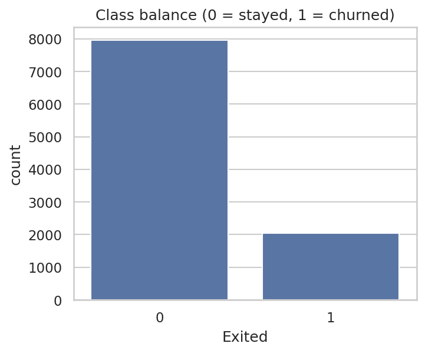
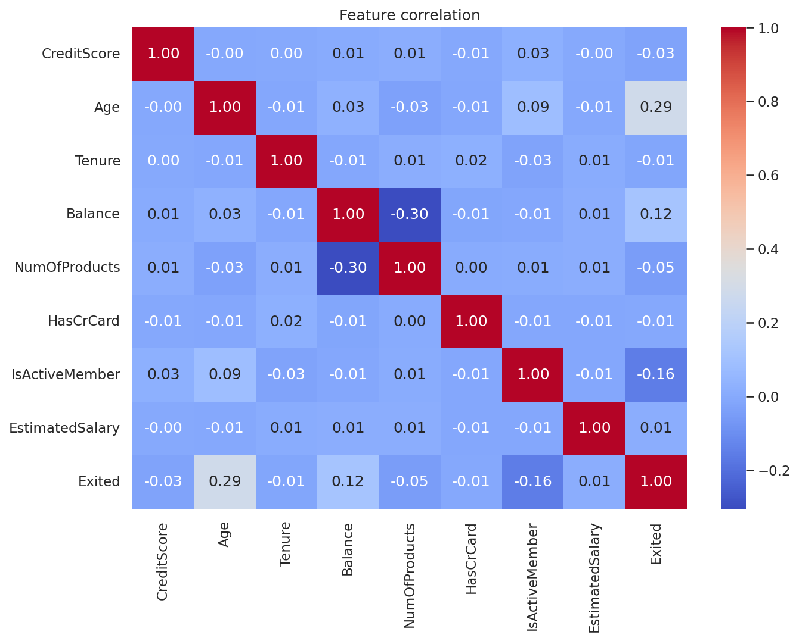
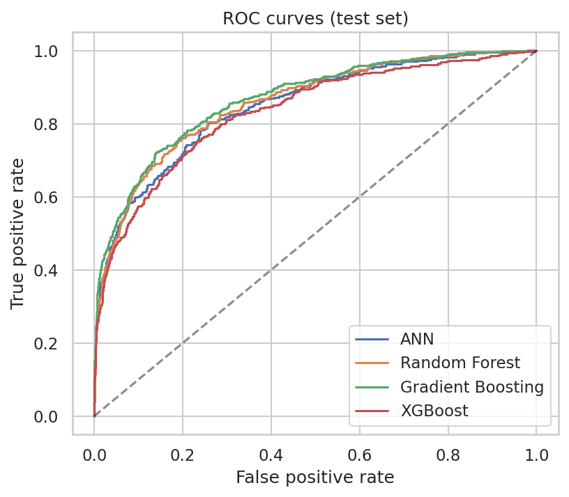
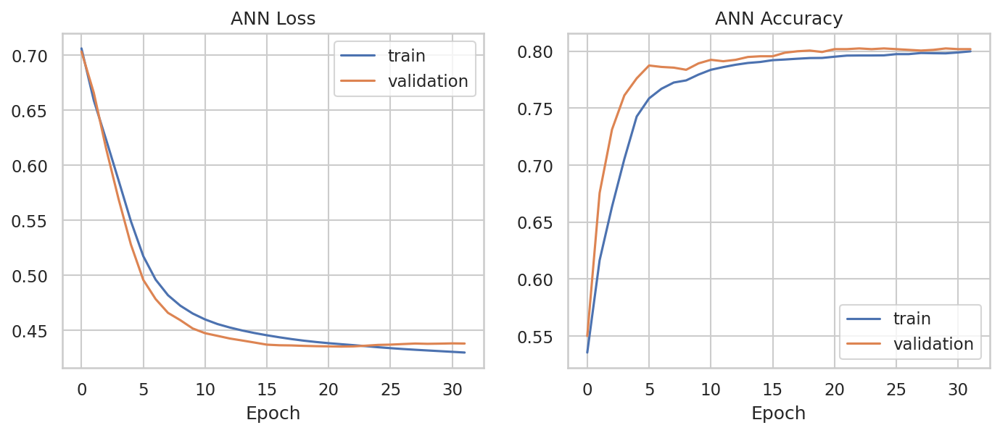
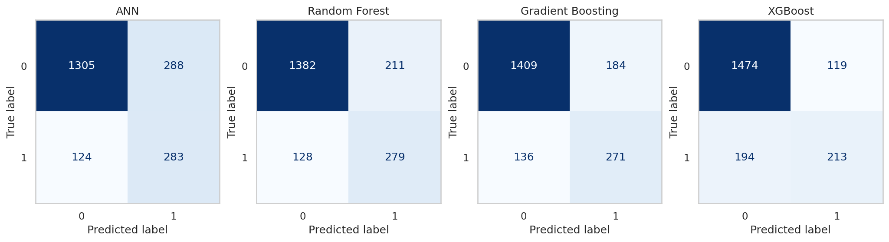

# Customer Churn Prediction

Predicting which bank customers are likely to leave, using an Artificial Neural Network (Keras/TensorFlow) and three tree-based baselines (Random Forest, Gradient Boosting, XGBoost). Class imbalance is handled with SMOTE, and models are compared on recall, F1 and ROC-AUC rather than accuracy alone.


## Table of contents
- [Problem statement](#problem-statement)
- [Dataset](#dataset)
- [Approach](#approach)
- [Results](#results)
- [Project structure](#project-structure)
- [Getting started](#getting-started)
- [Limitations and next steps](#limitations-and-next-steps)
- [Tech stack](#tech-stack)
- [Author](#author)

## Problem statement
Acquiring a new customer costs far more than retaining an existing one. Given a customer's profile and account behaviour, the goal is to predict whether they will churn (`Exited = 1`) so a retention team can act before they leave. This is a binary classification problem on an imbalanced dataset, so catching churners (recall) matters as much as overall accuracy.

## Dataset
`data/raw/Churn_Modelling.csv`: 10,000 bank customers, 14 columns, no missing values and no duplicate rows. The dataset is a widely used public churn dataset (available on Kaggle).

| Column | Description |
|---|---|
| `RowNumber`, `CustomerId`, `Surname` | Identifiers (dropped before modelling) |
| `CreditScore` | Customer credit score |
| `Geography` | Country: France, Spain or Germany |
| `Gender` | Female / Male |
| `Age` | Age in years |
| `Tenure` | Years as a customer |
| `Balance` | Account balance |
| `NumOfProducts` | Number of bank products held |
| `HasCrCard` | Has a credit card (0/1) |
| `IsActiveMember` | Active member (0/1) |
| `EstimatedSalary` | Estimated salary |
| `Exited` | **Target**: 1 if the customer churned |

Class balance: 7,963 stayed vs 2,037 churned (about 20% churn).

<p align="center">
  
  
</p>

## Approach
1. **Cleaning:** drop identifier columns; confirm no nulls or duplicates.
2. **Encoding:** `Gender` mapped to 0/1, `Geography` one-hot encoded (no artificial ordering between countries).
3. **Splitting:** stratified 64% train / 16% validation / 20% test.
4. **Scaling:** `StandardScaler` fitted on the training portion only, to avoid data leakage.
5. **Imbalance handling:** SMOTE applied to the training portion only. Validation and test sets keep the real class distribution.
6. **Models:**
   - ANN: 4 dense layers (10 → 6 → 10 → 1 sigmoid), Adam, binary cross-entropy, early stopping on validation loss.
   - Random Forest, Gradient Boosting and XGBoost baselines.
7. **Evaluation:** accuracy, precision, recall, F1 and ROC-AUC on the untouched test set (2,000 customers, threshold 0.5).

## Results
Test-set metrics from `python -m src.train` (seed 42, single split, no hyper-parameter tuning). Precision, recall and F1 are for the churn class.

| Model | Accuracy | Precision | Recall | F1 | ROC-AUC |
|---|---|---|---|---|---|
| ANN | 0.794 | 0.496 | **0.695** | 0.579 | 0.849 |
| Random Forest | 0.831 | 0.569 | 0.686 | 0.622 | 0.859 |
| Gradient Boosting | 0.840 | 0.596 | 0.666 | **0.629** | **0.867** |
| XGBoost | **0.844** | **0.642** | 0.523 | 0.577 | 0.835 |

- Gradient Boosting gives the best balance (highest F1 and ROC-AUC).
- The ANN catches the most churners (highest recall) but flags more false alarms.
- XGBoost with default settings has the best accuracy and precision but misses about half of the churners, which is why accuracy alone is a poor yardstick here.
- Differences between models are small and come from one split, so treat the ranking as indicative, not definitive. Exact figures may vary slightly across TensorFlow versions and hardware.

<p align="center">
  
  
</p>

<p align="center">
  
</p>

## Project structure
```
customer-churn-prediction/
├── data/
│   └── raw/Churn_Modelling.csv        # original dataset
├── notebooks/
│   └── 01_churn_ann_exploration.ipynb # original exploratory notebook
├── src/
│   ├── config.py                      # paths, seeds, hyper-parameters
│   ├── data.py                        # loading, encoding, splitting, scaling, SMOTE
│   ├── models.py                      # ANN + baseline model definitions
│   ├── visualize.py                   # plotting helpers
│   └── train.py                       # end-to-end training & evaluation
├── reports/
│   ├── metrics.json                   # latest test-set metrics
│   └── figures/                       # generated plots
├── models/                            # saved models (git-ignored)
├── requirements.txt
├── LICENSE
└── README.md
```

## Getting started
```bash
# 1. Clone the repository
git clone https://github.com/<your-username>/customer-churn-prediction.git
cd customer-churn-prediction

# 2. Create and activate a virtual environment
python -m venv .venv
source .venv/bin/activate        # Windows: .venv\Scripts\activate

# 3. Install dependencies
pip install -r requirements.txt

# 4. Train and evaluate all models
python -m src.train
```
This regenerates `reports/metrics.json`, everything in `reports/figures/` and the saved ANN in `models/`.

To explore the original analysis, run `jupyter notebook` and open `notebooks/01_churn_ann_exploration.ipynb`.

## Limitations and next steps
- Results come from a single train/test split; add stratified k-fold cross-validation for more stable estimates.
- No hyper-parameter tuning yet (e.g. `RandomizedSearchCV`, Keras Tuner).
- The 0.5 decision threshold is not optimised; tune it against the cost of a missed churner vs a wasted retention offer.
- Add model explainability (SHAP / feature importance) to show which factors drive churn.
- Wrap the best model in a small API or Streamlit app for scoring new customers.

## Tech stack
Python, pandas, NumPy, scikit-learn, imbalanced-learn, XGBoost, TensorFlow/Keras, Matplotlib, Seaborn, Jupyter.

## Author
**Yogeshwaran S**


